# AgriMind 农业智能辅助系统


基于 **FastAPI + Vue 3 + Hybrid RAG** 的全栈实践项目，将农场档案、田块环境、农事履历、农业知识与专家复核串联起来，为农业咨询和日常管理提供可追溯的辅助信息。

> 本项目是学生实践与功能演示系统，适合本地运行、学习和二次开发；尚未进行生产部署或田间效果验收，详见[当前边界](#当前边界)。

[核心亮点](#核心亮点) · [功能概览](#功能概览) · [界面预览](#界面预览) · [技术架构](#技术架构) · [快速开始](#快速开始) · [测试](#测试) · [常见问题](#常见问题)

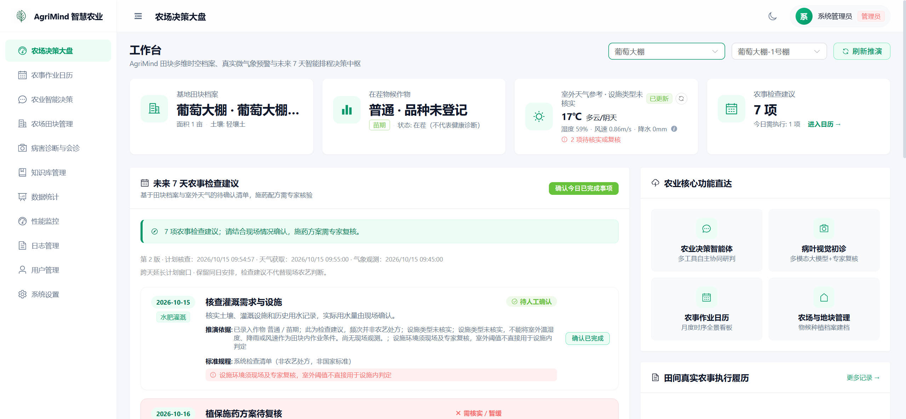

## 核心亮点

- **Hybrid RAG 检索**：先按作物、地域、生育期、来源、当前版本和有效期做硬过滤，再将 FAISS 向量得分与 BM25 关键词得分加权融合，并叠加来源等级、生育期和病害匹配加成；向量服务不可用时自动退回 BM25 并在结果中标明检索路径。
- **按意图编排工具**：农业分析根据问题意图调度田块画像、天气、农事历史、知识检索、图像初诊和积温计算六类工具，汇总依据、风险与建议。
- **人机协同复核**：病害初诊和咨询可转交农技专家认领；正式施药/采收复核须由专家或管理员签署，资料不足时不能批准，签署回执保留原记录。
- **请求回执一致性**：分析请求带编号，断网或关闭页面后服务端仍在时限内处理并保存回执，重连后可按原编号查询结果。
- **历史可追溯**：农场、田块归档而非删除，批次结束与恢复记录状态事件，现场观测追加保存；室外天气参考与棚内观测分开存储和展示。

## 功能概览

| 模块 | 已实现内容 |
|---|---|
| 农场与田块 | 农场位置、田块面积与设施类型、种植批次、生育阶段、批次状态历史、归档与恢复 |
| 工作台与农事日历 | 按农场、田块和批次查看检查建议、天气参考及农事履历，区分检查确认与实际作业记录 |
| 农业智能分析 | 结合田块档案、天气、历史农事、知识检索、图像初诊及积温参考，输出分析依据、风险和建议 |
| 病害初诊与会诊 | 上传现场图片、补充症状、关联批次、保存初诊记录、专家认领工单并提交复核意见 |
| 农业知识库 | 知识增删改查、JSON 导入导出、来源与版本标注、有效期过滤、向量索引管理及混合检索 |
| 履历与人工复核 | 农事记录、现场环境观测、用药安全间隔参考、农业咨询及施药/采收复核回执 |
| 系统管理 | 用户与专家注册审核、模型和气象配置、农业统计、性能监控、日志查询与请求关联 |
| 数据维护 | 数据库与诊断媒体备份包、独立恢复副本校验、编号结构升级及运行就绪检查 |

### 用户角色

| 角色 | 标识 | 主要职责 |
|---|---|---|
| 农户 | `customer` | 管理本人农场、田块和种植批次，录入履历，发起分析、初诊及专家咨询 |
| 农技专家 | `expert` | 查看授权的农业上下文，认领会诊与咨询，提交复核意见和人工签署 |
| 系统管理员 | `admin` | 管理用户及专家申请，维护知识与系统配置，并具有农业复核权限 |
| 历史客服角色 | `cs` | 项目由电商客服系统改造而来，保留该兼容身份；无专家复核或系统管理权限 |

登录页支持农户注册和专家申请；专家申请经管理员审核通过后才能登录。菜单可见性与具体数据访问范围分别由前后端校验。

## 界面预览

截图中的数据、模型名称及分析内容仅用于界面展示。

<details>
<summary>展开核心业务页面：田块、日历、智能分析与病害会诊</summary>

**农场田块管理**

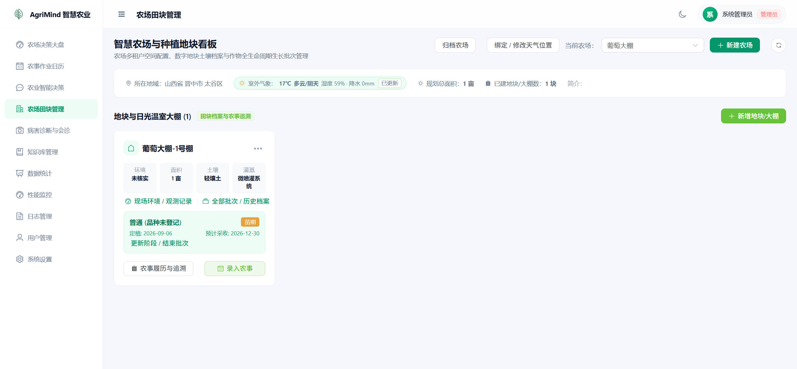

**农事作业日历**

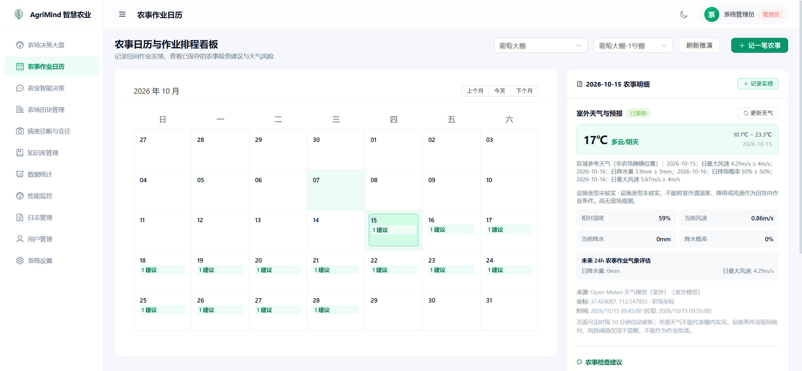

**农业智能决策**

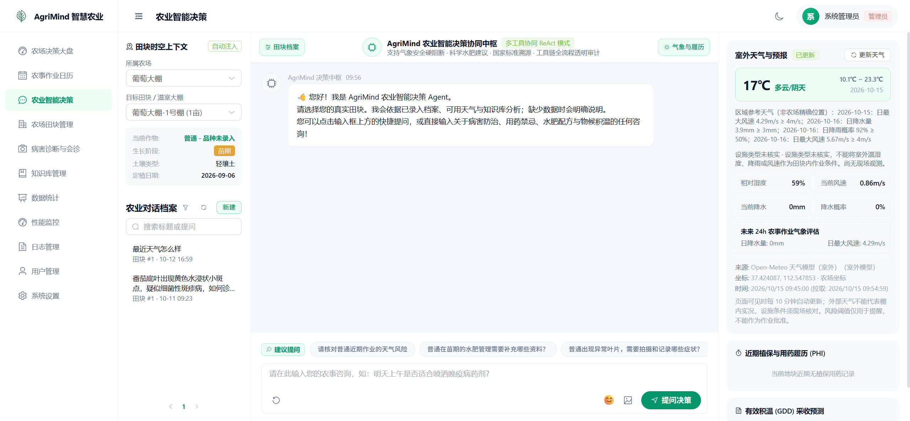

**病害诊断与会诊：农户端**

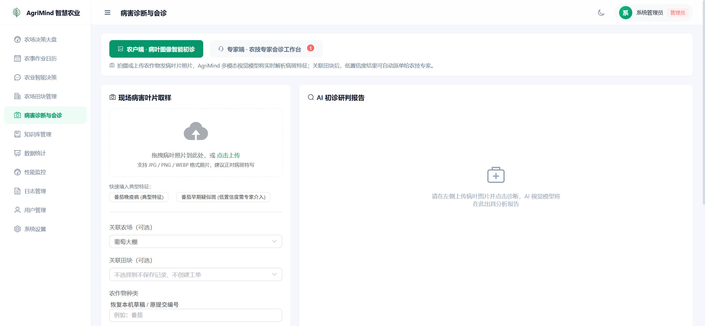

**病害诊断与会诊：专家端**

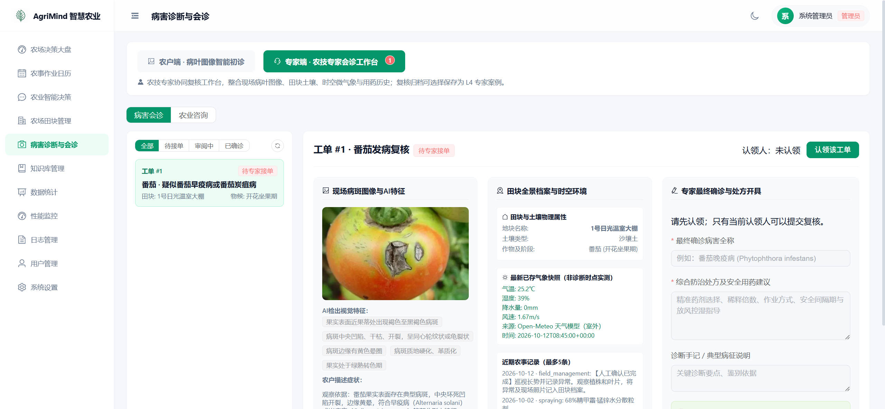

</details>

<details>
<summary>展开管理页面：知识库、统计、监控、日志、用户及系统设置</summary>

**知识库管理**

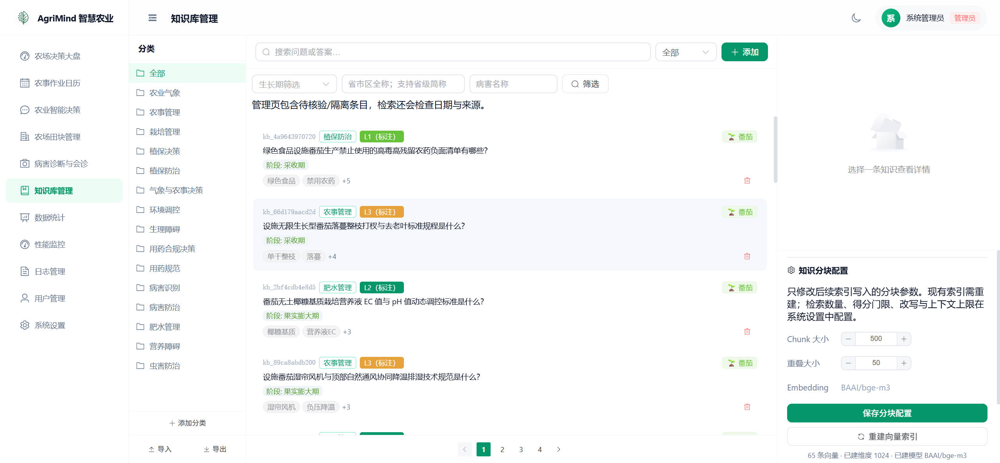

**数据统计**

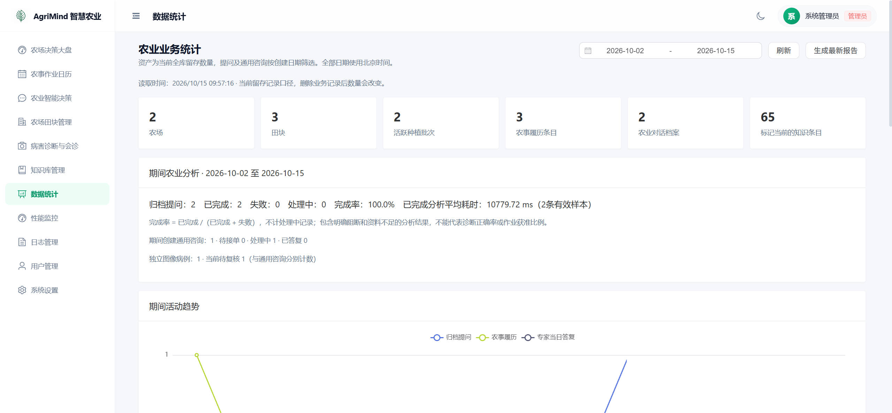

**性能监控**

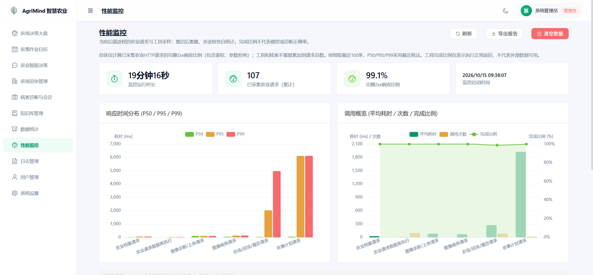

**日志管理**

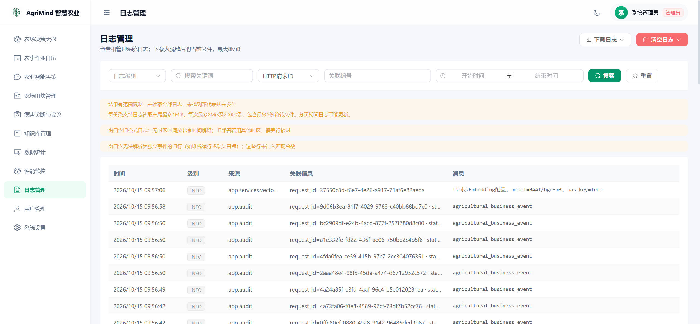

**用户管理**

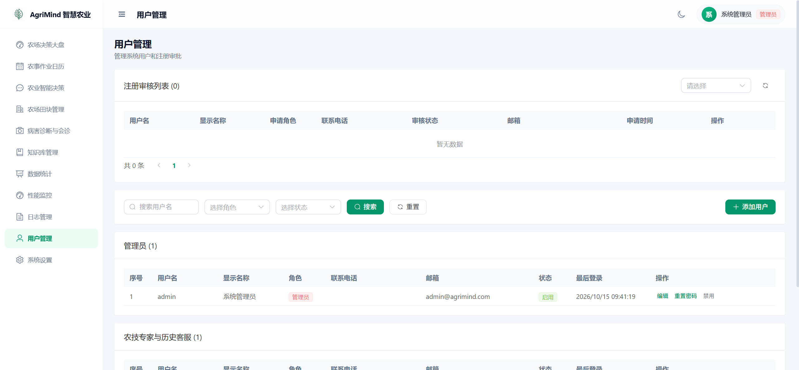

**系统设置**

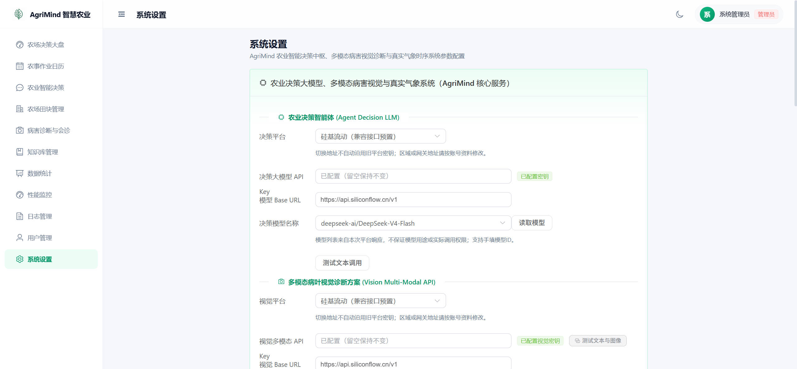

</details>

## 技术架构

| 层次 | 技术与职责 |
|---|---|
| 前端 | Vue 3、TypeScript、Vite、Pinia、Vue Router、Element Plus、ECharts |
| 后端 | Python、FastAPI、Pydantic、SQLAlchemy 异步会话、aiosqlite |
| 存储与检索 | SQLite 保存业务数据与知识元数据；FAISS 向量检索结合 BM25 关键词检索 |
| 外部服务 | 可配置的文本、视觉与 Embedding 服务；Open-Meteo 或自定义气象接口 |
| 工程验证 | pytest、Node.js 行为测试、vue-tsc、隔离构建及 GitHub Actions 工作流 |

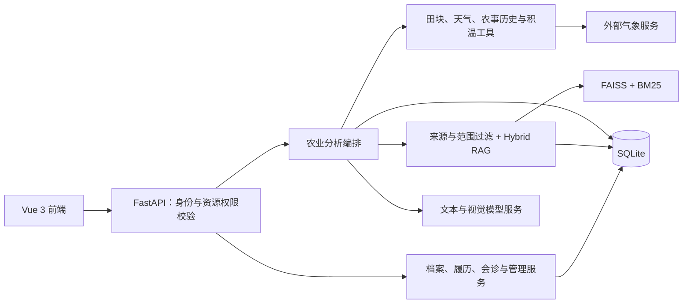

## 快速开始

### 1. 准备环境与依赖

需要 **Python 3.12** 与 **Node.js 20.19+ 或 22.12+**（推荐 22 LTS）。开发验证环境为 Windows；Linux / macOS 命令一并列出，但尚未做目标机验收。

克隆仓库后进入项目根目录，下文命令除标明 `cd frontend` 外均在根目录执行。

```bash
python -m venv .venv
```

```powershell
# Windows PowerShell
.\.venv\Scripts\Activate.ps1
```

```bash
# Linux / macOS
source .venv/bin/activate
```

> Windows 若提示"禁止运行脚本"，先在当前窗口执行 `Set-ExecutionPolicy -Scope Process RemoteSigned`，或改用 CMD 运行 `.venv\Scripts\activate.bat`。

```bash
python -m pip install -r backend/requirements.txt
cd frontend
npm ci
cd ..
```

也可使用 uv：`uv venv` 后执行 `uv pip install -r backend/requirements.txt`。`backend/requirements.lock` 是 Windows / Python 3.12 的解析记录，跨平台安装以 `requirements.txt` 为准。

### 2. 创建本地配置

将[配置模板](config/environment.example)复制为根目录 `.env`（该文件已被 `.gitignore` 忽略）：

```powershell
# Windows PowerShell
Copy-Item config/environment.example .env
```

```bash
# Linux / macOS
cp config/environment.example .env
```

生成 JWT 密钥：

```bash
python -c "import secrets; print(secrets.token_urlsafe(48))"
```

至少填写以下配置：

| 配置项 | 说明 |
|---|---|
| `APP_ENV` | 本地开发填 `development`；`ENV` 是兼容旧配置的备用变量，两者保持一致即可 |
| `JWT_SECRET_KEY` | 填入上面生成的随机值并长期保持不变，至少 32 字符 |
| `INITIAL_ADMIN_USERNAME` | 首次管理员用户名，最多 50 字符 |
| `INITIAL_ADMIN_PASSWORD` | 须与用户名同时设置，12 字符以上且不超过 72 个 UTF-8 字节 |
| `SETTINGS_ENCRYPTION_KEY` | 使用本地启动器时留空，首次启动会自动初始化并复用 |
| `ALLOW_DEMO_SEEDING` | 默认 `false`；想快速体验可设为 `true`，见[演示模式](#演示模式可选) |

模型 API 密钥可留空，之后在管理员"系统设置"页面填写。数据库、上传文件和日志路径默认根据项目位置生成，无需填写绝对路径。

### 3. 启动后端

```bash
# 首次启动：初始化配置加密密钥
python backend/run.py --initialize-encryption

# 以后启动
python backend/run.py
```

默认监听 `127.0.0.1:8000`，可用 `--port` 修改。未显式配置加密密钥时，启动器会把密钥保存在当前用户的 AgriMind 配置目录并在后续启动复用；迁移数据时须同时备份这把密钥，否则已保存的模型配置无法解密。初始化管理员只在用户名不存在时创建，之后修改配置不会重置密码。

### 4. 启动前端

另开终端：

```bash
cd frontend
npm run dev
```

| 入口 | 地址 |
|---|---|
| Web 页面 | <http://localhost:3000> |
| API 文档（仅开发模式） | <http://127.0.0.1:8000/docs> |
| 存活检查 | <http://127.0.0.1:8000/health> |
| 就绪检查 | <http://127.0.0.1:8000/ready> |

前端开发服务器会把 `/api` 请求代理到 8000 端口。

### 5. 配置 AI 服务

用管理员登录后进入"系统设置"，分别配置文本模型、视觉模型和 Embedding 服务，并用页面上的连接测试确认可用。

- 文本模型内置 OpenAI、硅基流动、通义千问、智谱 AI、DeepSeek 等提供商，默认使用硅基流动的 `Qwen/Qwen3-8B`；各服务均可填写 OpenAI 兼容格式的自定义 Base URL。
- 视觉模型用于病害图片初诊，Embedding 用于向量检索；更换 Embedding 模型后需在知识库页面重建索引。
- 未配置外部服务时，账号、档案、履历等本地功能照常可用；AI 分析会显示服务不可用或降级状态，知识检索退回 BM25。

### 6. 准备知识库

全新数据库没有知识条目，此时 `/ready` 显示降级属正常现象。管理员可在"知识库管理"中逐条录入，或导入 JSON 文件（条目数组，或包含 `items` 数组的导出文件）：

```json
[
  {
    "question": "番茄叶霉病有哪些症状？",
    "answer": "叶片正面出现淡黄色褪绿斑，背面对应部位长出灰紫色至黑褐色霉层……",
    "keywords": ["番茄", "叶霉病", "霉层"],
    "category": "病害防治",
    "crop": "番茄",
    "region": "通用",
    "growth_stage": "开花期",
    "topic": "disease",
    "disease": "番茄叶霉病",
    "source_type": "extension",
    "source_name": "某省农技推广站栽培指南",
    "authority_level": "L3",
    "version": "v1.0"
  }
]
```

> [!IMPORTANT]
> `source_type` 缺省为 `unverified`，这类条目和 `quarantined` 条目都**不会进入检索候选**。请按实际来源填写 `standard`（标准规范）、`literature`（专业文献）、`extension`（农技推广）或 `expert`（专家案例），并配合 `authority_level`（L1–L4）。来源标注只是录入信息，不代表内容已经核验。

### 演示模式（可选）

仅供本机快速体验：在 `.env` 中设置 `APP_ENV=development` 和 `ALLOW_DEMO_SEEDING=true` 后启动，系统会创建演示账号、一个示例农场（含温室田块、番茄批次和施药记录）以及番茄病害知识种子。

| 账号 | 密码 | 角色 |
|---|---|---|
| `admin` | `admin123` | 管理员 |
| `expert` | `expert123` | 农技专家 |
| `farmer` | `farmer123` | 农户 |

> [!WARNING]
> 演示账号使用公开的弱密码，仅限本机体验。非开发环境下不会创建这些账号；体验结束后建议将 `ALLOW_DEMO_SEEDING` 改回 `false`，并删除或修改这些账号。

### 体验流程

1. **管理员**：配置 AI 服务，导入知识并重建索引，审核专家申请。
2. **农户**：建立农场、田块和番茄批次，补充设施类型与位置，录入施药、灌溉等农事记录和现场观测。
3. **智能分析**：在"农业智能决策"中提问（如"开花期叶片发黄卷曲是什么原因"），查看引用依据、风险与建议。
4. **病害初诊**：在"病害诊断与会诊"中上传叶片图片并关联批次，需要时发起会诊。
5. **专家复核**：用专家账号认领工单，提交复核意见并签署；农户端查看回执与批次履历。

日历中的建议是**待核查清单**，不会自动变成已实施的施药、灌溉或施肥记录。

## 测试

完整工程验证（凭证模式扫描、依赖导入、后端全量测试、前端行为测试、类型检查和生产构建）：

```bash
python backend/tools/verify_all.py
```

任一步失败即返回非零退出码，日志保存在 `scratch/verification-<UUID>/`。也可分别执行：

```bash
# 后端隔离测试（项目根目录）
python backend/tools/run_agri_checks.py tests

# 前端行为测试、类型检查与构建
cd frontend
npm test
npm run typecheck
npm run build
```

自动化测试全部使用合成数据，默认禁用部署配置读取和真实 HTTP 调用，**不需要网络或付费 API 即可运行**。当前版本包含后端 900 余项、前端 180 余项测试。GitHub Actions 会在推送和 Pull Request 时运行后端测试及前端安装、类型检查、构建与行为测试。

测试不覆盖真实模型效果、浏览器端到端、负载及 Linux 目标机部署。

## 项目结构

```text
backend/
├── run.py               本地启动入口
├── app/
│   ├── api/             路由层
│   ├── core/            配置、模型提供商、向量存储、知识准入规则
│   ├── models/          SQLAlchemy 数据模型
│   ├── schemas/         Pydantic 数据契约
│   ├── services/        业务服务、RAG 与农业分析编排
│   ├── middleware/      审计上下文、限流与性能统计
│   └── migrations/      历史数据迁移与结构升级
├── tests/               后端单元及集成测试
├── tools/               验证、维护与源码导出工具
└── requirements.txt
frontend/
├── src/
│   ├── views/           页面
│   ├── components/      组件
│   ├── api/             接口封装
│   ├── stores/          Pinia 状态
│   └── router/          路由与权限
├── tests/               前端行为测试
└── tools/               隔离构建工具
config/                  无真实凭证的配置模板
image/                   README 截图
.github/workflows/       持续集成
```

运行时生成的 `data/`、`logs/`、`scratch/`、`dist/` 均已被 `.gitignore` 忽略。

## 数据备份与恢复

后端提供备份与数据导出接口，备份包可包含 SQLite 数据库和本地诊断图片。恢复与结构升级只在独立副本上进行，不会自动切换当前数据库：

```bash
python backend/tools/prepare_agri_restore.py --help
python backend/tools/upgrade_agri_copy.py --help
```

历史数据库须按编号升级流程处理，不要手工修改版本号绕过检查。更多维护工具见 [backend/tools/README.md](backend/tools/README.md)。

## 常见问题

| 问题 | 检查方式 |
|---|---|
| 首次启动后管理员无法登录 | 确认用户名和密码成对填写且满足长度要求；同名账号已存在时不会被重置密码 |
| 专家注册后不能登录 | 专家申请需要管理员审核通过 |
| `/health` 正常但 `/ready` 返回 503 | 检查数据/日志目录和知识候选；空库或只有未核验来源时会处于降级状态，该接口不探测模型服务 |
| 检索不到刚导入的资料 | 检查 `source_type` 是否为 `unverified`，以及版本、有效期、作物/地域范围；更换 Embedding 后需重建索引 |
| 已保存的模型配置无法解密 | 恢复原来的加密密钥；已有密文时不能用新密钥代替 |
| 修改后端端口后前端无法访问 | 同步修改 `frontend/vite.config.ts` 的代理目标；跨域访问还需核对后端 CORS 配置 |

## 当前边界

本项目用于工程实践和功能演示：

- 知识来源标注、法规与农药产品信息的真实性需要人工核对；模型自评分和检索得分不等于诊断准确率。
- 图像初诊、积温参考和检查计划尚未经过独立田间效果验证；室外天气不能代表棚内实时条件。
- 传感器接入、设施自动控制、生产参数校准及 Linux 实际部署属于后续工作。

## 许可

本项目基于 [MIT License](LICENSE) 开源。

`backend/app/data/` 中的行政区划数据来自第三方项目，分别遵循其原始许可（MIT、WTFPL），来源与许可说明见同目录下的 `*_SOURCE.md` 和 `*_LICENSE.txt`。
